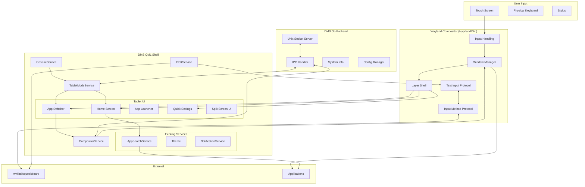

# Dux Shell - Tablet-First Linux Shell: Architecture Assessment Report

*Assessment conducted for converting Dux Shell into a tablet-first Linux desktop environment. Date: 2026-10-24*

## Table of Contents

1. [Executive Summary](#executive-summary)
2. [Repository Architecture](#repository-architecture)
3. [QML Architecture Analysis](#qml-architecture-analysis)
4. [Go Backend Architecture](#go-backend-architecture)
5. [Compositor Integration](#compositor-integration)
6. [Feature Reusability Assessment](#feature-reusability-assessment)
7. [Shell vs Compositor Responsibilities](#shell-vs-compositor-responsibilities)
8. [Compositor Comparison: Hyprland vs Niri](#compositor-comparison-hyprland-vs-niri)
9. [Technical Risks](#technical-risks)
10. [Proposed Architecture for Tablet-First Experience](#proposed-architecture-for-tablet-first-experience)
11. [Component Diagram](#component-diagram)
12. [Prioritized Implementation Plan](#prioritized-implementation-plan)
13. [Smallest Viable End-to-End Prototype](#smallest-viable-end-to-end-prototype)

---

## Executive Summary

Dux Shell (DMS) is a mature, modular Wayland desktop shell built on Quickshell (QML) with a Go backend. It already supports multiple compositors (niri, Hyprland, MangoWC, Sway, labwc, Scroll, Miracle WM) with sophisticated window/workspace management, IPC, theming, and extensibility.

The key challenge is transitioning from a **desktop shell with responsive behavior** to a **tablet-first shell** where:
- Full-screen apps are the default
- Touch is the primary input paradigm
- Home screen + app launcher are first-class
- App switcher optimized for touch
- Optional split-screen multitasking
- OSK integration matters
- Portrait/landscape support

The good news: Much of the infrastructure (compositor abstraction, IPC, services, theming) is reusable. The major work is in UI paradigm shifts, touch gesture handling, and proper integration with compositor window management APIs.

---

## Repository Architecture

### Monorepo Structure
```
dux-shell/
├── core/                    # Go backend (dms CLI + daemon)
│   ├── cmd/dms/             # CLI commands, IPC client/server
│   ├── internal/            # Core logic (server, config, IPC, etc.)
│   └── pkg/                 # Shared packages
├── quickshell/              # QML UI
│   ├── Common/              # Shared singletons, Theme, Settings
│   ├── Services/            # System integration (CompositorService, etc.)
│   ├── Modules/             # UI modules (bar, dock, lock, overlays)
│   ├── Modals/              # Modal dialogs/popouts
│   ├── Widgets/             # Reusable components (D* widgets)
│   ├── PLUGINS/             # Plugin examples
│   └── shell.qml            # Entry point
├── dux-qml-common/          # Submodule of shared QML widgets
└── distro/                  # Packaging
```

### Key Architectural Patterns
- **Singleton Services** in QML (`pragma Singleton`) for system state
- **Compositor abstraction** via `CompositorService` detecting and adapting to different WMs
- **IPC** between Go daemon (`dms` server) and QML via sockets
- **Layer Shell** for UI surfaces (bars, docks, overlays, lock screen)
- **Plugin system** for extensibility

---

## QML Architecture Analysis

### Core Entry Point
- `shell.qml` sets up the shell environment, waits for `DMSService` connection
- `DMSShell.qml` is the main orchestrator loading all UI components (lock, dock, modals, popouts, overlays)

### Compositor Abstraction (`CompositorService.qml`)
The crown jewel - already provides unified API across compositors:
- **Detection**: Auto-detects niri, Hyprland, MangoWC, Sway, Scroll, Miracle, labwc, Aqueous, Umbriel, KWin
- **Unified window management**: `sortedToplevels`, `activateToplevel()`, `toggleToplevel()`, `filterCurrentWorkspace()`, etc.
- **Compositor-specific services**: `NiriService`, `HyprlandService` for deep integration
- **Capabilities flags**: `supportsWorkspaces`, `supportsWindowRules`, `hasWorkspaceIpc`, `windowOverlapSupported`, etc.
- **Screen scaling/orientation handling**: `getScreenScale()` with compositor-specific logic

### Window/Workspace Model
- Uses `ToplevelManager` (from Quickshell) as base
- `CompositorService` enriches with compositor-specific metadata
- `WindowModel.js` has helpers for different compositors
- Already handles workspace filtering per screen, window activation

### UI Patterns
- **Lazy loading** for modals/popouts to reduce startup overhead
- **Variants** per screen for multi-monitor support
- **D* widgets** from `qs.DCommon.Widgets` (preferred over raw QtQuick)
- **Theme system** via `Theme.qml` singleton
- **Animations** via `Anims.qml`, `SpringMotion`

### Existing Launcher/App Drawer
- `DLauncherV2Modal` with multiple backends (host/spotlight/island styles)
- `AppDrawerPopout.qml` uses `DLauncherV2` components
- `AppSearchService` for app indexing/launching
- Touch-agnostic in many places but uses mouse/keyboard interactions primarily

### Overlays
- `NiriOverviewOverlay.qml` provides overview + spotlight integration for niri
- `HyprlandOverview.qml` exists
- Good foundation for app switcher concepts

---

## Go Backend Architecture

### Structure (`core/`)
- **CLI framework**: Cobra-based commands in `cmd/dms/`
- **Server**: Unix socket server (`internal/server/`) for IPC
- **Shell app management**: Uses `dux-go/shellapp` for launching/stopping quickshell
- **System integrations**: NetworkManager, BlueZ, Pipewire, brightness, etc.
- **Compositor-agnostic where possible**: Some compositor-specific logic in keybind providers

### IPC
- QML talks to Go via socket or direct Quickshell IPC
- `qsipc` package handles Quickshell IPC communication
- Rich command set exposed via `dms ipc call <target> <function>`

### Key Capabilities
- Matugen theming integration
- Screenshot utilities
- Keybind management per compositor
- Plugin management/registry
- Clipboard management
- Greeter integration

---

## Compositor Integration

### Supported Compositors
From README: niri, Hyprland, MangoWC, Sway, labwc, Scroll, Miracle WM, and others with reduced features.

### Integration Depth
| Compositor | Integration Level | Notes |
|------------|-------------------|-------|
| **niri** | Deep | Full workspace/overview integration, custom config generation, layout management, keyboard layout control |
| **Hyprland** | Deep | Lua config generation, window rules, special workspaces/scratchpads, monitor layout |
| **MangoWC** | Good | Window sorting, workspace support |
| **Sway/Scroll/Miracle** | Good | I3-compatible via Quickshell.I3 |
| **labwc** | Basic | Some limitations noted in code |
| **Aqueous/Umbriel** | Emerging | Newer compositor support |

### How Integration Works
1. **Detection**: `CompositorService.detectCompositor()` checks env vars (`HYPRLAND_INSTANCE_SIGNATURE`, `NIRI_SOCKET`, `SWAYSOCK`, etc.)
2. **Service instantiation**: Compositor-specific service (e.g., `NiriService`) connects to compositor IPC
3. **Abstraction layer**: `CompositorService` provides unified API, delegates to compositor services when needed
4. **Config generation**: DMS can generate compositor config snippets (especially niri/Hyprland)

---

## Feature Reusability Assessment

| Feature | Reusability | Notes |
|---------|-------------|-------|
| **Theme System** | ★★★★★ Reuse as-is | Excellent, Material Design 3, works everywhere |
| **Settings/Config** | ★★★★★ Reuse as-is | Robust settings system |
| **IPC/Server** | ★★★★★ Reuse as-is | Foundation for all communication |
| **App Search/Launcher** | ★★★★☆ Adapt | `AppSearchService` + `DLauncherV2` reusable, but UI paradigm needs tablet-optimized version (full-screen home/app grid, larger touch targets) |
| **Window Management Abstraction** | ★★★★★ Reuse as-is | `CompositorService` already abstracts window ops - critical! Don't reimplement in QML |
| **Workspace Management** | ★★★★☆ Adapt | Works for desktop, need tablet-optimized switcher (gesture-based, card view) |
| **Notifications** | ★★★★☆ Adapt | Need touch-friendly notification center, swipe-to-dismiss |
| **Quick Settings/Control Center** | ★★★★☆ Adapt | Can reuse logic, needs larger touch targets, different layout |
| **Lock Screen** | ★★★★☆ Adapt | Needs tablet-optimized auth (PIN, biometrics-friendly), OSK integration |
| **Dock/Bar** | ★★☆☆☆ Major adaptation | Traditional bars less useful on tablet; may become minimal or gesture-revealed |
| **Plugins** | ★★★★★ Reuse as-is | Plugin system is compositor-agnostic |
| **Multi-monitor** | ★★★★☆ Adapt | Tablets often single screen, but need to handle orientation changes |

---

## Shell vs Compositor Responsibilities

### Shell Responsibilities (QML/Go)
- **UI/UX**: All visual shell elements (home screen, app launcher, switcher, settings UI)
- **Application launching**: Via `AppSearchService`/desktop entries
- **Theming/styling**: Matugen + theme system
- **System services UI**: Volume, brightness, network UI
- **Notifications**: Displaying and managing notification UI
- **IPC coordination**: Orchestrating between components
- **Touch gesture interpretation**: Shell-level gestures (swipe up for home, swipe between apps)
- **OSK coordination**: Requesting/showing OSK when text input focused
- **Orientation handling**: Adapting UI layout to portrait/landscape

### Compositor Responsibilities (Wayland Compositor)
- **Window management**: Actual window positioning, stacking, focus
- **Output management**: Display configuration, rotation/orientation
- **Input handling**: Touch, stylus, keyboard, mouse input routing
- **Layer surfaces**: Compositing shell surfaces
- **Text input protocol**: `text-input-v3`, `input-method-v2` for OSK
- **Window tiling/splitting**: Native split-screen if compositor supports it
- **Gestures**: Some compositors support native gestures
- **Focus management**: Critical for input routing

**Critical Rule from AGENTS.md:** *"Do not implement fake window-management behavior inside QML. Keep changes modular and independently testable."* - This aligns perfectly. We must use compositor APIs.

---

## Compositor Comparison: Hyprland vs Niri

Both are excellent choices. Need to evaluate for tablet use case.

### Overview

| Aspect | **Hyprland** | **Niri** |
|--------|--------------|----------|
| **Philosophy** | Dynamic tiling with floating support, very configurable | Scrollable-tiling (infinite workspace in columns), unique UX |
| **Maturity** | Very mature, large community | Mature, growing adoption |
| **Wayland Protocol Support** | Good coverage | Good coverage |
| **DMS Integration** | Deep (Lua config gen, window rules, special workspaces) | Deep (KDL config gen, layout, overview, recent-windows) |

### Window Management for Tablet

| Feature | Hyprland | Niri | Notes |
|---------|----------|------|-------|
| **Maximized apps** | Excellent - fullscreen, pseudo-tile, maximize | Excellent - fullscreen mode, column expansion | Both can do full-screen easily |
| **Window switching** | `focuswindow`, cyclings, alt-tab via scripts | `focus-column-*`, `focus-window-*`, has recent-windows in overview | Niri's column model is different; need adapter in shell |
| **Split-screen/multitasking** | Great - dwindle/master layouts, can split dynamically, can use `movewindow` to arrange | Great - columns can be arranged, windows side-by-side in columns, very flexible | Both support side-by-side. Niri's model is more "columns of windows" vs traditional tiling |
| **Tiling behavior** | Highly configurable per-workspace/layout | More opinionated but elegant scrolling model | For tablet (full-screen default), need to control this |
| **Floating windows** | First-class, easy to toggle | Supported but less emphasized | May need floating for some UI elements |
| **Window rules** | Powerful Lua-based rules | KDL window rules | DMS already generates rules for both |

### Touch/Gestures

| Feature | Hyprland | Niri | Notes |
|---------|----------|------|-------|
| **Touch input** | Good support via libinput, `input` config for touchpads/touchscreens | Good support via libinput | Both handle basic touch |
| **Gestures** | Has gesture support in recent versions (`gestures {}`), configurable | Has some gesture support, improving | Varies by version |
| **Swipe to switch** | Possible via gestures or keybinds triggered externally | Possible | Shell can interpret gestures and call compositor APIs |
| **Edge swipes** | Configurable | Limited native gesture API | Often better to handle in shell via input regions or use compositor actions |

### Text Input / OSK

| Feature | Hyprland | Niri | Notes |
|---------|----------|------|-------|
| **text-input-v3** | Supported | Supported | Both support modern text input protocol |
| **input-method-v2 (for OSK)** | Supported | Supported | Critical for on-screen keyboards like wvkbd, squeekboard |
| **Virtual keyboard protocol** | Supported | Supported | Compositor must support for OSK to work |
| **Focus handling** | Generally good | Generally good | Critical - need to ensure proper activation |

### Orientation / Display

| Feature | Hyprland | Niri | Notes |
|---------|----------|------|-------|
| **Output rotation** | `transform` in monitor config, can change at runtime | `transform` in output config, runtime changes possible via `niri msg output` | Both support rotation |
| **Dynamic orientation** | Supported, can script on events | Supported | DMS has `randr` CLI and display config support for both |
| **Per-output config** | Yes | Yes | DMS already manages output configs |
| **Scale factors** | Flexible | Flexible | Handled by `CompositorService.getScreenScale()` |

### Automation/API

| Feature | Hyprland | Niri | Notes |
|---------|----------|------|-------|
| **IPC/API** | Hyprland socket + hyprctl, rich API | Unix socket JSON API, very well-designed | Both scriptable |
| **DMS integration quality** | Excellent | Excellent | Both deeply integrated already |
| **Window state queries** | `hyprctl clients`, JSON | `niri msg -j windows`, detailed JSON | Both provide good info |
| **Action execution** | `hyprctl dispatch <action>` | `niri msg action <action>` or JSON requests | Niri's JSON API is cleaner |
| **Events** | Event socket with rich events | Event stream over socket | Both have event streams; DMS listens to them |

### Tablet-Specific Considerations

| Factor | Hyprland | Niri | Recommendation |
|--------|----------|------|---------------|
| **Default behavior for tablet** | More flexible - can configure to be very window-manager-minimal | Scrolling model is different; can feel unusual if not adapted | **Hyprland** easier to force "full-screen app by default" behavior |
| **Split-screen UX** | Familiar to desktop users, easy to understand | Column-based can be powerful but learning curve | **Hyprland** more intuitive for split-screen |
| **Gesture integration** | Better gesture support historically | Improving | **Hyprland** slight edge |
| **Resource usage** | Generally efficient | Generally efficient | Both fine |
| **Stability on touch** | Good track record | Good track record | Both viable |
| **Documentation for scripting** | Extensive | Good and growing | **Hyprland** more examples online |

### Verdict

**Recommendation: Start with Hyprland, keep Niri as secondary target.**

Reasons:
1. **Easier to enforce tablet paradigm**: Hyprland's flexible window rules/layouts make it easier to force full-screen by default, control floating behavior, and implement split-screen in a familiar way
2. **Better gesture ecosystem**: More mature gesture support and easier to integrate
3. **Familiar mental model**: Split-screen as "two windows side by side" is more intuitive than niri's column model for tablet users
4. **Easier to lock down chrome**: Can be more aggressive about window behavior
5. **DMS already has deep Hyprland support** - leverage existing Lua generation for dynamic config

That said, **Niri is also viable** and has some elegant properties (workspaces as columns concept maps interestingly to app switching). The abstraction layer in DMS means supporting both is feasible long-term, but starting with one is wise.

---

## Technical Risks

### Critical Risks

| Risk | Severity | Likelihood | Mitigation |
|------|----------|------------|------------|
| **Touch input handling** | 🔴 Critical | High | Test early on real tablet/hardware. Quickshell handles touch events, but need proper gesture recognition. May need to use Qt's touch/mouse event handling carefully. |
| **On-Screen Keyboard integration** | 🔴 Critical | High | Requires compositor support for `input-method-v2` and `text-input-v3`. Need to coordinate with OSK daemons (wvkbd, squeekboard). Test focus handling extensively. DMS already has some IM handling. |
| **Focus handling** | 🔴 Critical | High | On tablet, focus management is tricky - tapping app should focus it, OSK needs to know where to send input, modals need focus. Must follow compositor protocols strictly. |
| **Window management without fake behavior** | 🔴 Critical | High | Must use compositor APIs exclusively. Risk of trying to do window management in QML. Stay disciplined about using `CompositorService`. |
| **App switching UX** | 🟠 High | High | Need gesture-based switcher. Performance critical for smoothness. Must work well with full-screen apps. |

### High Risks

| Risk | Severity | Likelihood | Mitigation |
|------|----------|------------|------------|
| **Orientation changes** | 🟠 High | High | UI must adapt layout. Compositor handles rotation, shell must respond to screen changes. `Quickshell.screens` changes on rotation. Need to test portrait/landscape thoroughly. |
| **Split-screen multitasking** | 🟠 High | Medium | Compositor does the actual splitting. Shell needs to provide UI to trigger it and manage it. Need to ensure both apps are focusable and resizable properly. |
| **Performance on tablet hardware** | 🟠 High | Medium | Tablets often have weaker GPUs. Need to be careful about animations, blur, effects. DMS already has performance considerations. May need to disable heavy effects by default on tablet mode. |
| **Text input in all apps** | 🟠 High | Medium | Regular desktop apps expect proper IME support. Depends heavily on compositor + OSK + toolkit integration. |
| **Gesture conflicts** | 🟠 High | Medium | Shell gestures vs compositor gestures vs app gestures can conflict. Need careful design of gesture zones. |

### Medium Risks

| Risk | Severity | Likelihood | Mitigation |
|------|----------|------------|------------|
| **Breaking existing desktop functionality** | 🟡 Medium | Medium | Must maintain backward compatibility. Use feature flags/settings for tablet mode. Don't restructure core abstractions. |
| **Different compositor behaviors** | 🟡 Medium | Medium | Focus on Hyprland first, abstract differences. Niri support can come later. |
| **Plugin compatibility** | 🟡 Medium | Low | Existing plugins should still work if we don't break APIs. |
| **Settings migration** | 🟡 Medium | Low | Add new settings, don't break existing ones. |

---

## Proposed Architecture for Tablet-First Experience

### Core Principles
1. **Compositor-driven window management** - Never fake it in QML
2. **Touch-first UI** - Large touch targets (minimum 48-56dp), gesture navigation
3. **Full-screen default** - Apps launch maximized/fullscreen-like
4. **Minimal chrome** - Hide bars by default, gesture-revealed
5. **Modular design** - Tablet mode as a configurable mode, not a complete rewrite
6. **Reuse existing abstractions** - Leverage `CompositorService`, services, theming

### New Components Needed

```
quickshell/
├── Modules/
│   ├── Tablet/
│   │   ├── TabletHomeScreen.qml      # Home screen with app grid
│   │   ├── TabletAppSwitcher.qml     # Gesture-based app switcher
│   │   ├── TabletDock.qml            # Minimal touch dock (optional)
│   │   ├── TabletQuickSettings.qml   # Touch-optimized quick settings
│   │   ├── TabletLauncher.qml        # Full-screen app launcher
│   │   └── TabletGestureLayer.qml    # Global gesture detection
│   ├── SplitScreen/
│   │   ├── SplitScreenManager.qml    # UI for managing split view
│   │   └── SplitScreenDivider.qml    # Touch-draggable divider
│   └── OSK/
│       └── OSKManager.qml            # OSK coordination/showing
├── Services/
│   ├── TabletModeService.qml         # Tablet mode state/orchestration
│   ├── GestureService.qml            # Gesture recognition
│   └── OSKService.qml                # OSK integration
└── Common/
    └── TouchUtils.js                # Touch helper utilities
```

### Architecture Diagram



### Key Design Decisions

#### 1. Tablet Mode Toggle
- Add `tabletMode` setting (auto-detect based on touchscreen presence, or manual toggle)
- When enabled, different UI paradigm takes over
- Can be disabled to fall back to desktop-like behavior

#### 2. Home Screen as Default
- On boot/unlock in tablet mode, show home screen
- Home screen shows app grid/favorites
- Swipe up from bottom to go home, swipe from edges for other actions

#### 3. App Switching
- Use compositor's window list via `CompositorService.sortedToplevels`
- Gesture-based: swipe up from bottom and hold/swipe horizontally to switch
- Or recent apps view
- **Must call `CompositorService.activateToplevel()` to switch** - no manual window management

#### 4. Split-Screen
- Leverage compositor's tiling/splitting capabilities
- Hyprland: can use `movewindow` with directions, or change layout
- Provide UI affordance (split button in app switcher or gesture)
- Track split state in shell for UI purposes
- **Compositor does the actual work**

#### 5. Full-Screen Apps
- Configure compositor to prefer tiled/maximized for apps in tablet mode
- Use window rules to auto-maximize or fullscreen certain apps
- DMS can generate these rules dynamically

#### 6. Touch Gestures
- Implement gesture recognition in QML using `MultiPointTouchArea` or `TouchPoint`
- Define gesture zones (bottom edge for home/switcher, left/right edges for back/nav)
- Gesture service interprets and triggers actions
- Be careful not to conflict with compositor gestures

#### 7. OSK Integration
- Monitor text input focus via Wayland protocols (Quickshell may provide access)
- When text input is active and OSK not visible, show OSK
- Can use `wvkbd` or `squeekboard` - launch via Go backend or let compositor handle
- Need to coordinate positioning (OSK takes bottom screen space)

#### 8. Orientation
- Listen to screen changes (`Quickshell.screens`)
- Reflow layouts for portrait/landscape
- Home screen grid columns adjust
- Quick settings layout adapts

---

## Prioritized Implementation Plan

### Phase 0: Research & Validation (1-2 weeks)
**Goal:** Validate assumptions against real hardware/compositor behavior

- [ ] **Set up test environment** with Hyprland + DMS
- [ ] **Test touch input** in current DMS - does Quickshell receive touch events?
- [ ] **Test text input/IME** with wvkbd/squeekboard
- [ ] **Test window management APIs** - can we control fullscreen/maximize via compositor?
- [ ] **Test split-screen** in Hyprland manually
- [ ] **Test orientation changes** and screen rotation
- [ ] **Document compositor capabilities** discovered

**Acceptance Criteria:**
- Touch events are detectable in QML
- OSK can be shown/hidden and receives input
- Can fullscreen/maximize windows via Hyprland IPC
- Can create side-by-side windows
- Screen rotation is detectable

### Phase 1: Foundation (2-3 weeks)
**Goal:** Add tablet mode infrastructure without breaking existing functionality

- [ ] **Add tablet mode settings** to `SettingsData.qml` and `SettingsSpec.js`
- [ ] **Create `TabletModeService.qml`** singleton for state management
- [ ] **Create `GestureService.qml`** for touch gesture detection
- [ ] **Add touchscreen detection** (via `Proc` or system info)
- [ ] **Create tablet mode toggle in settings UI**
- [ ] **Add feature flag checks throughout codebase** (guard tablet-specific UI)

**Acceptance Criteria:**
- Can toggle tablet mode on/off
- Touchscreen auto-detection works
- No regression in desktop mode
- Services load without errors

### Phase 2: Core UI Paradigm (3-4 weeks)
**Goal:** Home screen, app launcher, basic navigation

- [ ] **Create `TabletHomeScreen.qml`** - full-screen home with app grid
- [ ] **Create `TabletLauncher.qml`** - full-screen app drawer/launcher optimized for touch
- [ ] **Integrate with `AppSearchService`** for app launching
- [ ] **Implement swipe-up-to-home gesture**
- [ ] **Auto-show home screen on launch in tablet mode**
- [ ] **Add app favorites/pinning**
- [ ] **Touch-optimized styling** (larger icons, more padding)

**Acceptance Criteria:**
- Home screen displays installed apps in grid
- Can launch apps from home screen
- Swipe up gesture goes home
- Works in portrait and landscape
- Touch targets are >= 48x48

### Phase 3: App Switching (2-3 weeks)
**Goal:** Touch-optimized app switcher

- [ ] **Create `TabletAppSwitcher.qml`** - card-based app switcher
- [ ] **Gesture to invoke switcher** (swipe up and hold, or swipe from bottom)
- [ ] **Show running apps** from `CompositorService.sortedToplevels`
- [ ] **Switch apps via `CompositorService.activateToplevel()`**
- [ ] **Close apps from switcher** (if compositor supports)
- [ ] **Smooth animations**
- [ ] **Keyboard navigation fallback** (if physical keyboard attached)

**Acceptance Criteria:**
- Can view all running apps in switcher
- Can switch between apps with tap/gesture
- Uses compositor APIs only (no fake window management)
- Smooth 60fps animations
- Works correctly with full-screen apps

### Phase 4: Split-Screen Multitasking (2-3 weeks)
**Goal:** Two-app split view

- [ ] **Create `SplitScreenManager.qml`** - orchestrate split
- [ ] **Hyprland integration** for splitting (window rules/layout manipulation)
- [ ] **UI to enter split mode** (from switcher or gesture)
- [ ] **Touch-draggable divider** `SplitScreenDivider.qml`
- [ ] **Track split state** per workspace/screen
- [ ] **Exit split mode** back to single app
- [ ] **Focus management** between split apps

**Acceptance Criteria:**
- Can split screen between two apps
- Can resize split with draggable divider
- Both apps remain functional and focusable
- Can exit split mode
- Uses compositor tiling (not manual positioning in QML)

### Phase 5: Touch UI Polish (2-3 weeks)
**Goal:** Quick settings, notifications, lock screen for tablet

- [ ] **Tablet-optimized Quick Settings** - larger toggles, rearranged
- [ ] **Swipe down from top for quick settings**
- [ ] **Notification center** - swipe to dismiss, larger touch targets
- [ ] **Lock screen tablet optimization** - numeric PIN option, larger buttons
- [ ] **Minimal/chrome-free by default** - hide bar/dock in tablet mode
- [ ] **Gesture-revealed chrome** if needed
- [ ] **OSK integration** via `OSKService.qml`

**Acceptance Criteria:**
- Quick settings usable with touch
- Notifications swipeable
- Lock screen works well with touch and OSK
- No persistent chrome blocking apps
- OSK appears for text inputs

### Phase 6: Orientation & Testing (1-2 weeks)
**Goal:** Portrait/landscape, polish, testing

- [ ] **Portrait/landscape layouts** for all tablet UI
- [ ] **Handle screen rotation** smoothly
- [ ] **Test on different aspect ratios**
- [ ] **Performance optimization** (reduce effects if needed)
- [ ] **Edge case handling**
- [ ] **Documentation**

**Acceptance Criteria:**
- UI adapts correctly to rotation
- No layout breaks in portrait or landscape
- Acceptable performance
- All core flows work end-to-end

**Total estimated time: 12-17 weeks** depending on complexity and testing needs.

---

## Smallest Viable End-to-End Prototype

Focus on minimal path that proves the concept works.

### MVP Scope
**Goal:** Demonstrate tablet-first experience with core functionality

**Must Have:**
1. Tablet mode toggle
2. Full-screen home screen with app grid
3. Launch apps from home
4. Basic app switcher (gesture or button)
5. Full-screen apps by default
6. Touch-friendly navigation

**Nice to Have (can defer):**
- Split-screen
- Advanced gestures
- Perfect OSK integration (can test with external OSK)
- All polish

### MVP Implementation Steps

#### Step 1: Infrastructure (1-2 days)
```qml
// Add to SettingsData.qml
property bool tabletMode: false
property bool tabletModeAutoDetect: true
```
Create `TabletModeService.qml` singleton.

#### Step 2: Home Screen (2-3 days)
Create minimal full-screen home:
- Grid of app icons from `AppSearchService`
- Tap to launch
- Uses `SessionService.launchDesktopEntry()` or `AppSearchService` launch method

#### Step 3: Make Apps Full-Screen (1-2 days)
Add Hyprland window rules to auto-maximize/focus:
```lua
-- In HyprlandService config generation
windowrulev2 = fullscreen, class:^(.*)$  -- or be more selective
```
Or set per-app rules. Need to test behavior.

#### Step 4: Simple App Switcher (2-3 days)
Use existing `CompositorService.sortedToplevels`:
- Overlay showing app thumbnails/cards
- Tap to call `CompositorService.activateToplevel()`
- Trigger via button or simple gesture

#### Step 5: Integration (1-2 days)
- Hook up to `DMSShell.qml` - load tablet UI when `TabletModeService.enabled`
- Hide/minimize desktop chrome in tablet mode
- Test full flow

**MVP Timeline: ~1-2 weeks**

### MVP Test Plan
- [ ] Enable tablet mode
- [ ] See home screen on startup
- [ ] Launch an app from home → app goes fullscreen
- [ ] Open app switcher → see running apps
- [ ] Switch to different app → works correctly
- [ ] Return home → can launch another app
- [ ] Touch input works throughout
- [ ] Works in landscape (and ideally portrait)

### MVP Success Criteria
The prototype proves:
1. We can create a tablet-optimized UI layer on top of DMS
2. We can leverage existing compositor abstraction without reimplementing window management
3. Touch-first navigation is feasible
4. Apps run full-screen as desired
5. Architecture is extensible for full feature set

---

## Recommendations

### Immediate Actions
1. **Read AGENTS.md again carefully** - Follow all rules (especially "Do not implement fake window-management behavior inside QML")
2. **Start with Hyprland** for prototyping
3. **Don't fork the backend** - The Go backend is mostly compositor-agnostic and reusable
4. **Keep changes additive** - New tablet modules/services, don't gut existing desktop code
5. **Test early on real hardware** - Emulation/simulation won't catch touch/OSK issues

### Key Principles to Follow
- **Use `CompositorService` for all window operations** - This is the abstraction layer
- **Keep QML focused on UI** - Business logic in services
- **Respect compositor authority** - Compositor owns window positions, focus, etc.
- **Maintain backward compatibility** - Desktop mode must continue to work
- **Be conservative with animations/effects** - Performance matters on tablets
- **Follow existing code style** - Read surrounding code before making changes

### Potential Pitfalls to Avoid
- **Don't build a custom window manager in QML** - Tempting but wrong; use compositor
- **Don't ignore OSK** - Text input is broken without it on tablet
- **Don't assume mouse input** - Everything must work with touch
- **Don't break multi-monitor** - Even if tablet is single screen now, architecture should be compatible
- **Don't hardcode values** - Use Theme tokens, follow DMS patterns

---

## Appendix

### Useful References in Codebase
- `quickshell/Services/CompositorService.qml` - Window management abstraction (1360+ lines, very important)
- `quickshell/Services/NiriService.qml` / `HyprlandService.qml` - Compositor-specific implementations
- `quickshell/DMSShell.qml` - Main shell orchestration
- `quickshell/Modules/WorkspaceOverlays/NiriOverviewOverlay.qml` - Existing overview pattern
- `core/cmd/dms/shellapp.go` - Shell launching logic
- `AGENTS.md` - Project rules and conventions

### External Resources to Consult
- [Quickshell Documentation](https://quickshell.org/)
- [Hyprland Wiki](https://wiki.hyprland.org/)
- [Niri Documentation](https://yalter.github.io/niri/)
- [Wayland Protocols](https://wayland.app/protocols/) - Especially text-input, input-method, layer-shell
- [wvkbd](https://github.com/jjsullivan5196/wvkbd) - On-screen keyboard

---

*This assessment is based on analysis of the repository as it exists. All recommendations should be validated against actual compositor behavior and hardware testing.*
